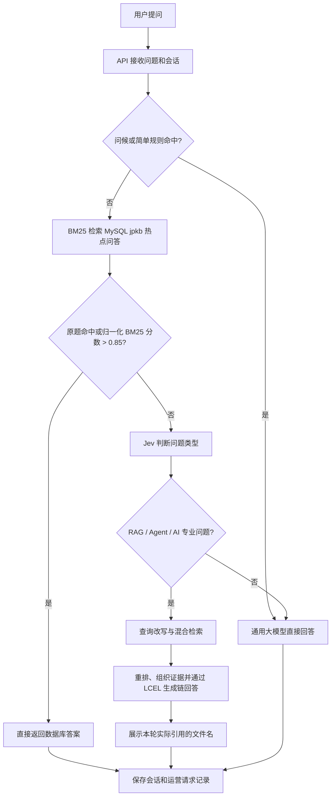

# 集成问答系统架构

## 系统定位

本项目为 AI、Agent、RAG 等专业资料提供问答。在线请求先用 BM25 匹配 MySQL `jpkb` 热点问答；匹配分数高于 0.85 时直接返回对应答案。没有命中时由 Jev 判断问题类型：专业问题进入完整 RAG，通用问题直接交给大模型。简单问候使用通用固定话术。RAG 回答展示本轮实际检索到的知识文件名。

本文的状态只描述仓库里能看到的实现，不代表已经通过真实数据验证或具备生产部署条件：

- **[已实现]**：主要逻辑已写入代码，并有明确调用入口。
- **[部分实现]**：已有可用代码，但仍有链路、可靠性、数据或部署方面的缺口。
- **[新增·已实现]**：原架构新增的模块，目前已有代码；仍需按下文限制理解其成熟度。
- **[待新增]**：架构已规划，仓库还没有对应实现。

## 模块目录与状态

```text
integrated_qa_system/
├── api/                                      [部分实现] HTTP、WebSocket 接入和依赖装配
│   ├── server.py                             [已实现] 创建 FastAPI、装配路由/静态页面、HTTP trace_id 中间件
│   ├── routes_qa.py                          [部分实现] 问答、流式问答、会话与健康检查；返回反馈关联编号
│   ├── routes_docs.py                        [新增·已实现] 上传文档、查看摄取任务和文档状态、重试失败任务
│   ├── routes_eval.py                        [新增·已实现] 上传评测集、后台执行评测、读取报告
│   ├── routes_ops.py                         [新增·已实现] 用户反馈、命中统计、问题候选及人工审核接口
│   ├── deps.py                               [部分实现] 进程内问答/摄取服务单例；没有登录身份和租户注入
│   └── schema.py                             [部分实现] 问答请求结构已有；引用及反馈响应协议需要继续统一
│
├── base/                                     [部分实现] 公共配置、日志与请求追踪
│   ├── config.py                             [已实现] 从环境变量、.env 和 config.ini 读取配置
│   ├── logger.py                             [已实现] 创建项目日志记录器
│   └── tracing.py                            [新增·部分实现] HTTP trace_id 与阶段计时工具；尚未贯穿每个内部阶段
│
├── storage/                                  [部分实现] MySQL、Redis 中的结构化数据与缓存
│   ├── db.py                                 [部分实现] MySQL 单连接客户端；连接池和并发安全待加固
│   ├── preprocess.py                         [已实现] 中文文本分词和检索预处理
│   ├── documents.py                          [新增·已实现] 文档哈希、摄取状态、失败信息和重试所需字段
│   ├── conversations.py                      [已实现] 保存、读取、清理最近会话历史
│   ├── cache.py                              [部分实现] Redis 基础操作；仍需统一准入与失效策略
│   ├── faq.py                                [新增·已实现] FAQ BM25/向量两级检索、静态答案准入、知识版本缓存
│   ├── subject_qa.py                          [已有·已调整] 检索项目原有 jpkb 热点问答：精确匹配或归一化 BM25 > 0.85 时直接返回答案
│   ├── intent_samples.py                     [新增·已实现] 意图代表问句和标准答案的存储、导入、停用
│   └── ops.py                                [新增·部分实现] 请求脱敏日志、反馈、FAQ 候选审核和命中层统计；聚类仅做规范化完全匹配
│
├── rag_qa/
│   ├── schema/
│   │   ├── chunk.py                          [已实现] 检索和入库统一使用的 Chunk 结构
│   │   └── citation.py                       [新增·部分实现] 上下文编号、引用来源对象和编号校验
│   ├── corpus/
│   │   ├── processor.py                      [已实现] 多格式文档加载、清理、分层切分
│   │   ├── loaders/                          [已实现] PDF、Word、PPT、图片和 OCR 加载器
│   │   ├── splitters/                        [已实现] 递归切分及模型辅助切分
│   │   ├── dedup.py                          [新增·已实现] 根据内容哈希识别新文件、重复文件和更新文件
│   │   └── indexer.py                        [新增·部分实现] 文档解析、Milvus 写入、状态更新和失败记录
│   ├── retriever/                            [已实现代码] 嵌入、Milvus、稠密与稀疏混合召回
│   ├── reranker/rerank.py                    [已实现] 对召回文本重新排序
│   ├── generation/
│   │   ├── llm.py                            [已实现] 大模型同步/流式调用及 LCEL Runnable 适配
│   │   └── prompts.py                        [部分实现] RAG/通用/改写提示模板；生成链含证据和引用要求
│   ├── query/rewriter.py                     [已实现代码] HyDE、子查询和回溯查询改写
│   ├── router/
│   │   ├── intent.py                         [部分实现] 问候等简单规则分流
│   │   ├── intent_retriever.py               [保留模块] 代表问句 BM25 检索，不再接入在线主路由
│   │   ├── jev_classifier.py                  [新增·已实现] 调用 Jev 区分专业 RAG 与通用大模型；需要 JEV_API_KEY
│   │   ├── classifier.py                     [已实现·离线保留] 原有 BERT 分类器，用于独立评测
│   │   └── strategy.py                       [已实现] 按查询选择 RAG 检索/改写策略
│   ├── pipeline/
│   │   ├── qa.py                             [部分实现] 手写业务编排 + LCEL 改写/生成链；租户过滤需从可信身份贯穿
│   │   ├── integrated.py                     [部分实现] 连接热点问答 BM25、Jev、RAG/通用回答、会话和请求日志
│   │   └── ingest.py                          [部分实现] 上传任务与索引编排；任务队列和状态查询为单进程方案
│   ├── evaluation/
│   │   ├── dataset.py                        [已实现] JSONL 评测样本读取和字段校验
│   │   ├── runner.py                         [已实现代码] 批量运行 RAG/意图预测、生成报告和比较基线
│   │   ├── metrics.py                        [已实现代码] 意图、检索排序和字面答案指标
│   │   ├── baselines.md                      [已实现] 如何记录基线和解释指标
│   │   └── README.md                         [已实现] 评测数据格式和运行说明
│   └── main.py                               [已实现] 命令行问答及文档处理入口
│
├── frontend/                                 [新增·已实现] 从 UltraRAG 前端迁入布局与样式后改造的智学答 React 工作台
│   ├── src/App.jsx                           [新增·已实现] 问答、会话、知识库、评测和运营页面；请求本项目 API
│   ├── src/pages/chat-page.css               [参考迁入] UltraRAG 聊天工作台页面布局样式
│   ├── src/pages/chat-mobile.css              [参考迁入] 聊天工作台小屏适配样式
│   ├── src/app/styles/                       [部分参考迁入] 基础设计变量与组件样式
│   ├── src/app/styles/zhixueda.css            [新增·已实现] 智学答品牌、主题和管理页样式
│   ├── index.html                            [新增·已实现] 前端构建入口
│   └── vite.config.js                        [新增·已实现] 开发代理和构建到 static/ 的配置
├── static/                                   [构建产物] FastAPI 提供的前端页面与打包资源
└── tests/test_pipeline_smoke.py               [已有] 冒烟检查脚本；本次改动未运行测试
```

## 每个模块具体做什么

下面按一次请求从进入系统到产生答案的顺序说明。可以把系统理解成几个分工明确的部分：前端收集问题，API 接请求，问答流程决定答案从哪里来，存储和检索模块提供数据，日志与评测帮助判断运行结果。

### 项目入口与前端

| 模块 | 主要职责 | 关键文件 / 说明 |
|---|---|---|
| `frontend/`（新增） | 智学答自己的 React 页面。展示聊天工作台，也提供文档上传、评测和运营日志页面；界面请求本项目 API，不调用 UltraRAG 服务。 | `src/App.jsx` 管理页面、会话与 API 交互；`src/main.jsx` 加载应用和样式；`vite.config.js` 配置开发代理，并把生产构建写入 `static/`。 |
| `frontend/src/pages/`（参考迁入） | 提供聊天工作台和窄屏布局的基础样式，保留 UltraRAG 的侧栏、历史会话、对话区和输入栏的布局风格。 | `chat-page.css` 是主要工作台样式；`chat-mobile.css` 放小屏布局规则。 |
| `frontend/src/app/styles/` | 定义通用 CSS、颜色和智学答自己的页面样式。 | `tokens.css` 是设计变量；`globals.css` 是基础组件样式；`zhixueda.css` 负责品牌、主题以及知识库、评测和运营页面样式。 |
| `static/` | 存放 Vite 打包后的网页和静态资源，由 FastAPI 返回给浏览器。 | 这是构建产物，不是前端源码；修改页面应改 `frontend/` 后重新构建。 |
| `api/server.py` | 创建 FastAPI 应用，挂载 API 路由和 `static/`，提供首页、健康状态和 HTTP 请求日志。 | HTTP 中间件为每个请求写入 `trace_id`，记录路径、状态码和耗时。 |
| `api/deps.py` | 管理共享业务对象的创建时机。 | 问答和文档摄取服务在相关接口首次调用时才初始化，不因打开首页而提前连接数据库或模型。 |

### API 接入层

`api/` 负责网络协议和参数校验，不负责实现检索算法。前端页面通过它和后端业务交互：

| 文件 | 做什么 |
|---|---|
| `routes_qa.py` | 管理会话创建、历史读取和清理；接收普通问答请求；需要逐段回答时通过 WebSocket 发送开始、文本片段、结束或错误消息。健康检查和知识来源选项也在这里。 |
| `routes_docs.py` | 接收上传文件和知识来源，检查文件大小与来源是否合法，提交入库；提供任务状态、文档清单和失败任务重试接口。 |
| `routes_eval.py` | 接收 JSONL 评测集，先检查数据格式，再创建后台评测任务；另提供任务状态和最近一次评测报告。 |
| `routes_ops.py` | 保存回答反馈，读取命中层统计和脱敏请求记录；把常见未命中问题整理为候选，并提供人工审核入口。 |
| `schema.py` | 定义 API 请求与响应共用的数据结构，避免前后端对字段含义理解不一致。 |
| `README.md` | 说明 API 模块职责、本地启动步骤和运行依赖。 |

### 公共基础能力

| 模块 | 做什么 | 关键文件 |
|---|---|---|
| `base/config.py` | 从环境变量、`.env` 和 `config.ini` 读取模型、数据库、检索、日志等配置；集中处理密钥读取和缺失提醒。 | 修改连接地址或阈值时优先改配置，不要把真实密钥写进业务代码。 |
| `base/logger.py` | 创建项目共用日志器，把日志写到终端和 `logs/app.log`；文件按大小轮转并保留备份，每行带 `trace_id`。 | API 和业务模块共用同一个日志入口。 |
| `base/tracing.py` | 在异步请求上下文中保存当前 `trace_id`，并提供测量一段代码耗时的工具。 | 当前 HTTP 请求和 WebSocket 连接已记录编号；更细的内部阶段还没有全部接入追踪。 |

### 数据存储与知识运营

`storage/` 管理数据库、缓存以及问答业务需要长期保存的数据。业务流程通过这些接口读取和写入数据，不应在前端直接访问数据库。

| 文件 | 做什么 |
|---|---|
| `db.py` | 提供 MySQL 连接和 SQL 执行基础能力；当前连接管理仍需进一步增强并发与连接池支持。 |
| `preprocess.py` | 统一清理、分词和规范化中文文本，供关键词检索等功能使用。 |
| `conversations.py` | 保存和读取用户会话中的问答历史，并支持清理历史。 |
| `cache.py` | 封装 Redis 缓存读写，减少重复访问；缓存版本和失效规则仍需完善。 |
| `faq.py` | 查找经过维护、可以直接复用的 FAQ 答案；先做精确匹配，再做 BM25 字面检索和向量语义检索。 |
| `subject_qa.py` | 从项目已有的 `jpkb` 表读取问题和答案；原题精确命中，或近似问句的归一化 BM25 分数严格大于 0.85 时，直接复用对应数据库答案。 |
| `intent_samples.py` | 保存意图代表问句、所属意图和可选标准答案，为“按问句检索意图”提供样本数据。 |
| `documents.py` | 保存文档身份、内容哈希、摄取状态、失败原因和重试信息，避免只靠内存记住文档处理进度。 |
| `ops.py` | 保存请求日志与用户反馈，统计各答案层使用情况，并管理待人工审核的知识候选。当前候选聚合较简单，不能视为完整语义聚类。 |
| `README.md` | 说明存储模块的职责和数据流向。 |

### RAG 问答与文档处理

`rag_qa/` 是问答和知识处理的核心。它把原始资料处理成可检索的文本，再根据用户问题找到依据并组织答案。

| 子模块 | 做什么 | 主要内容 |
|---|---|---|
| `schema/` | 规定模块之间传递的数据格式。 | `chunk.py` 统一文本块及其来源信息；`citation.py` 表示引用来源并检查答案引用编号是否对应本次提供的证据。 |
| `corpus/` | 把用户上传的文件变成可检索的知识块。 | `loaders/` 读取 PDF、Word、PPT、普通文档和图片/OCR；`splitters/` 按文本结构或模型辅助方式切分；`processor.py` 组织加载、清理和切分；`dedup.py` 计算内容哈希识别重复或更新；`indexer.py` 将处理结果写入向量库并更新文档状态。 |
| `retriever/` | 根据问题从知识库找出候选文本。 | `embedding.py` 把文本转成向量；`milvus_store.py` 读写 Milvus；`hybrid.py` 合并向量和关键词召回；`base.py` 规定检索器共用的接口。 |
| `reranker/` | 对首轮召回结果再排序。 | `rerank.py` 使用重排模型判断哪些文本块更贴近当前问题，并截取较相关的证据。 |
| `query/` | 改写复杂问题以改善召回。 | `rewriter.py` 提供 HyDE、拆分子问题和回溯补充检索等策略。 |
| `router/` | 决定请求走数据库答案、专业 RAG 还是通用模型。 | `intent.py` 返回通用问候话术；`jev_classifier.py` 调用 Jev 判断专业或通用问题；`strategy.py` 为专业问题选择检索策略。原 `intent_retriever.py` 和 BERT `classifier.py` 不参与在线主路由。 |
| `generation/` | 根据检索证据生成自然语言回答。 | `llm.py` 调用大模型，并把项目已有 `complete/stream` 客户端适配为 LCEL Runnable；`prompts.py` 定义 RAG、通用回答和查询改写模板。 |
| `pipeline/qa.py` | 执行单次完整 RAG 问答。 | 分类、分支、检索和引用校验继续使用普通 Python 编排；策略选择、HyDE/子查询/回溯改写以及 RAG/通用回答使用 `PromptTemplate \| Runnable \| StrOutputParser` LCEL 链，普通与流式输出分别装配。 |
| `pipeline/integrated.py` | 串接在线问答流程。 | 先检查 `jpkb` 热点问答；未命中时调用 Jev，专业问题进入 RAG，通用问题直接由大模型回答；同时保存会话和运营请求记录。 |
| `pipeline/ingest.py` | 编排上传文档的后台处理。 | 接收任务、调用索引器、维护任务状态并处理失败；当前调度器以单进程为范围。 |
| `classify_data/` | 保存问题分类器和提示词相关的训练/配置数据。 | `model_generic_5000.json` 是分类数据样例；文本文件记录分类提示。 |
| `models/` | 保存本地运行所需的模型文件。 | 包括问题分类、中文基础模型、文本向量模型和重排模型；权重文件本身不是业务代码。 |
| `data/` | 保存待处理或用于知识库构建的原始资料。 | 当前包含 AI 学习资料 PDF；上传文件目录也由配置指定。 |
| `main.py` | 提供命令行使用入口。 | 可在没有浏览器页面时运行问答或文档处理相关操作。 |
| `README.md` | 说明 RAG 核心模块的总职责。 | `corpus/`、`retriever/` 等子目录另有各自说明文件。 |

### 评测模块

`rag_qa/evaluation/` 用来回答“当前检索和问答效果怎么样”，而不是在线处理普通用户提问。

| 文件 | 做什么 |
|---|---|
| `dataset.py` | 逐行加载 JSONL 评测集，检查必需字段、样本编号和数据类型。 |
| `runner.py` | 按评测模式批量调用意图预测或 RAG 问答，收集输出并保存本次运行报告。 |
| `metrics.py` | 对照人工标注计算意图识别、检索排序和答案字面匹配等指标。 |
| `baselines.md` | 记录基线结果及解释，便于后续比较修改前后的变化。 |
| `README.md` | 说明评测 JSONL 的字段格式和运行方法。 |

评测代码的组织方式参考 UltraRAG `servers/benchmark` 与 `servers/evaluation`；本项目使用自己的数据字段、业务入口和指标实现。是否达到目标仍要用项目自己的人工标注数据运行确认。

### 其他根目录内容

| 路径 | 做什么 |
|---|---|
| `config.ini` | 保存非密钥的默认配置，例如 MySQL 地址、检索参数和日志文件位置。 |
| `.env` / `.env.example` | `.env` 放本机密钥，不应分享或提交；`.env.example` 展示需要配置的变量名称和示例。 |
| `requirements.txt` | 记录 Python 后端需要安装的第三方包版本。 |
| `logs/` | 保存服务日志及轮转后的历史日志文件。 |
| `tests/` | 放置管线冒烟检查等自动化验证代码；具体运行方式见 `tests/README.md`。 |

## 在线业务流程



当前在线流程不使用向量相似度做意图判定。热点问答近似匹配将 BM25 原始分数用 `score / (score + 1)` 映射到 0—1，再以严格大于 0.85 作为直答门槛；这是初始规则，仍需用标注数据评测误命中。BM25 未命中时由 Jev 分类；Jev 置信度不足或 API 不可用时，问题安全地进入完整 RAG。

查询改写和最终文本生成采用局部 LCEL 链：提示模板先产出 `PromptValue`，模型适配器将其转换为项目客户端可接收的文本，最后由 `StrOutputParser` 统一输出字符串。主路由没有改成一个大型 `RunnableBranch`，因为热点直答、Jev 回退、循环检索、引用校验、会话和运营日志包含较多条件分支与副作用，保留显式 Python 编排更便于理解、调试和记录阶段信息。

## 前端工作台

`frontend/` 是本项目自己的 React 前端。它迁入 UltraRAG 的聊天工作台布局与视觉样式（侧栏、历史会话、中央对话区和底部输入区），并以“智学答”品牌重新编写页面和交互；前端的数据接口全部指向本项目的 FastAPI，不启动也不依赖 UltraRAG 服务。知识库、评测、运营日志页面分别使用本项目的文档、评测和运营 API。Vite 构建会把页面和静态资源写入 `static/`，由 `api/server.py` 提供首页。

本地运行前端开发模式：在 `frontend/` 执行 `pnpm install` 和 `pnpm dev`；运行完整应用时先执行 `pnpm build`，再按 API README 启动 FastAPI。普通页面启动不要求 MySQL、Redis、Milvus 或模型服务在线；首次问答、文档摄取和运营查询会按功能连接相应依赖。

## 文档摄取与评测流程

```text
文档上传 → 文件校验和保存 → 内容哈希去重 → 加载与切分 → Milvus 写入 → 更新文档状态
                                                            └→ 失败时记录原因并允许重试

人工整理 JSONL 评测集 → runner 批量调用当前问答/意图预测器 → 计算指标 → 保存报告 → 与基线比较
```

评测实现参考本机 UltraRAG 项目的 `servers/benchmark` 和 `servers/evaluation` 目录：借鉴数据集组织、批量运行和评价步骤分离的思路。本项目的数据格式、调用入口、指标和报告按自己的 RAG/Chunk 接口实现，不把参考项目的代码或能力算作本项目实现。仓库目前没有足以校准生产阈值的真实标注评测集和稳定实测基线。

## 意图识别为什么是“把分类问题改成检索问题”

在线路由由 Jev 完成。系统向 Jev 提供两个选项：专业 RAG 问题、通用大模型问题；专业范围包括 RAG、Agent、AI 与相关工程实践。Jev 返回选项和置信度，低置信度或服务不可用时回退到完整 RAG。它只决定路线，不负责搜索答案。

BM25 在 Jev 之前检查 MySQL `jpkb` 热点问答。完整问题一致时直接返回；近似问句的原始 BM25 分数通过 `score / (score + 1)` 映射到 0—1，严格大于 0.85 才允许使用对应数据库答案。低于门槛不返回最相似答案，继续交给 Jev。该归一化方式和阈值是当前工程规则，必须用标注的相关问题与相似负例验证。

仓库中的 `intent_samples` 和 `intent_retriever.py` 仍可用于代表问句数据管理或离线分析，但不再参与在线主路由；其中的 BM25 检索不使用向量兜底。原有 BERT `classifier.py` 保留用于离线比较，在线问答由 Jev 分类器驱动。

## 企业能力覆盖和实际限制

| 能力 | 当前实现情况 | 还缺什么 |
|---|---|---|
| 热点问答答案复用 | 已接入 `jpkb` 精确匹配和归一化 BM25 > 0.85 直答 | 用真实标注问句校准阈值并观察误命中率 |
| Jev 问题路由 | 已实现专业/通用二分类与置信度门槛；在线调用需要 API 密钥 | 申请密钥、验证服务可用性，并用本项目数据评测 |
| 文档去重与重试 | 部分实现：哈希判断、状态表、索引器及上传 API 已有 | 更新时保留旧索引的安全切换、持久化队列、跨进程任务状态和真实存储联调 |
| 多租户 | 部分实现：部分存储和 Milvus 字段支持租户条件 | 身份认证与授权、可信 tenant_id 透传、所有表/缓存隔离验证；客户端传入的 tenant_id 不能作为可信身份 |
| 评测闭环 | 部分实现：JSONL、指标、runner、报告和 API 已有 | 项目真实标注集、稳定基线、语义质量评估、CI 回归门禁 |
| 引用与拒答 | 部分实现：上下文编号、非流式引用编号校验、流式答案显示实际引用文件名 | 流式答案最终校验、引用支持度评估和拒答指标 |
| trace 与耗时 | 部分实现：HTTP trace_id、响应头和请求总耗时日志已有 | 把同一编号与各内部阶段关联；可靠获取模型 token 用量和费用 |
| 知识运营 | 部分实现：日志脱敏、反馈存储、未覆盖问题汇总、候选审核及 FAQ 回填已有 | 语义聚类、API/UI 操作入口、反馈编号回传、异步写入和并发连接池 |
| 生产可靠性 | 部分实现 | 数据库连接池、持久化任务队列、鉴权、限流、部署监控、备份恢复和压测 |

因此，这套架构已经覆盖企业 RAG 系统的主要模块和演进方向，但当前代码不能称为完整企业级生产系统：身份与权限、异步任务、并发数据库访问、观测指标、真实评测和运行验证仍需补齐。

## 实施顺序与原因

建议的顺序不是按“哪个模块看起来最复杂”排列，而是按依赖和风险排列。每一步的产物都能作为下一步的检查依据。

### 第一阶段：整理热点问答评测集

从现有 `jpkb` 题库抽取真实问句与答案，再补充人工确认的同义问法、容易混淆的相似问题和完全无关的问题。标记每条用户问句应当命中哪个题库答案，或应当拒绝复用题库答案。数据要覆盖短问句、长问句、关键词重合但意思不同的负例。

**参考情况：** 评测数据运行步骤参考 UltraRAG 的 `servers/benchmark` 和 `servers/evaluation` 目录；本项目的问句、答案和标注由自己维护。

**为什么先做：** BM25 命中会直接把数据库答案展示给用户，误命中比漏命中更容易造成错误回复。没有正例和关键词相似的负例，就不知道 0.85 是否能拦住无关问题。先准备评测数据，才能计算误命中率与覆盖率，再决定是否调整门槛。

### 第二阶段：接入数据库热点问答 BM25

对 `jpkb.question` 建立 BM25 索引。完整问句命中可直接返回；近似匹配将 BM25 原始分数映射到 0—1，只有分数严格大于 0.85 时才复用对应数据库答案。没有通过门槛的问题不能返回 BM25 排名第一的答案。

**为什么这样做：** 用户已有题库，准确命中时直接返回数据库答案比重新生成更稳定；而近似匹配要有明确准入门槛，避免关键词偶然重合就误答。该门槛不是未经评测即可保证准确的通用常数。

### 第三阶段：接入 Jev 专业领域分类

给 Jev 两个明确的输出选项：RAG/Agent/AI 专业问题，以及通用知识问题。专业问题进入现有完整 RAG；其他问题跳过知识库检索，直接调用通用大模型。配置置信度下限，低置信度或接口调用失败时使用完整 RAG 作为安全回退。

**为什么放在 BM25 之后：** 数据库热点问答已经有可信答案时，无需再付出分类调用；数据库无法可靠回答时，才需要决定此问题是否应使用专业资料检索。Jev 只作路由，不作为回答模型。

### 第四阶段：补齐完整 RAG 的质量与溯源

统一 Chunk 中的文档、页码和块编号；让模型引用上下文编号；校验来源编号存在后再返回给客户端。使用同一评测集衡量检索召回、排序、答案质量和无依据拒答。

**参考情况：** 复用当前 Milvus、嵌入、重排与 LLM 组件；不替换已有问答能力，只完善结果协议和评估。

**为什么在复用链路之后：** 直接答案层和 RAG 都会给用户结果，必须使用共同评测集比较质量；引用信息来自实际检索块，所以应建立在稳定的 Chunk 元数据上。

### 第五阶段：完善文档入库和知识运营

增加可恢复的任务队列和索引版本切换；定时把重复高频未命中问题整理为候选，由人审核后写入 FAQ 或意图代表问句，然后重新跑评测。

**参考情况：** 评测批量运行方式参考 UltraRAG 上述目录；文档状态机、运营表和管理流程属于本项目自己的实现。

**为什么此时做：** 若在线命中和答案质量尚未可测，自动汇总和审核候选很难判断是否真的改善效果。队列和安全索引切换又依赖明确的摄取状态及失败恢复策略。

### 第六阶段：生产化加固

接入认证与授权、可信租户注入、连接池、限流、持久化队列、内部阶段追踪、token 成本统计、备份恢复和压测；建立部署后监控和回滚流程。

**为什么最后做：** 这些能力应覆盖已稳定的业务链路；此阶段仍需要逐项实现，不能因为架构图中列出就视为已经具备。

## 运行边界

- 数据库、Redis、Milvus、模型文件和大模型 API 必须按 `config.ini` / 环境变量配置；外部服务不可用时，相应链路无法完成真实联调。
- 文档摄取任务当前由单进程内存调度。服务重启后可从文档状态发现未完成记录，但不能保证原任务队列自动恢复。
- 目前没有鉴权，默认租户值只适合个人单租户运行，不能用作真实多租户的安全边界。
- BM25、向量相似度阈值是待标注集校准的起始参数，不是已验证指标。
- 评测代码和 API 已存在不等于已经有实测结果。正式比较前需要创建本项目标注集并保存第一份稳定基线。
- UltraRAG 只作为评测目录组织和运行步骤拆分的参考来源；请勿把它的能力描述成当前项目已实现。
